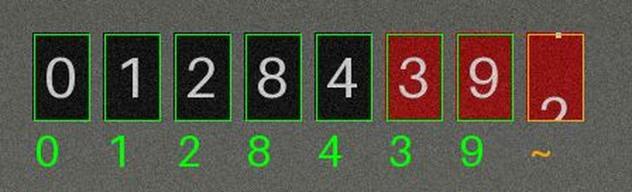

<p align="center">
  <picture>
    <source media="(prefers-color-scheme: dark)" srcset="custom_components/android_meter/brand/dark_logo.png"/>
    
  </picture>
</p>

<p align="center">
  <a href="https://github.com/renaudallard/homeassistant_android_meter/releases/latest">
    
  </a>
  <a href="https://github.com/renaudallard/homeassistant_android_meter/releases">
    
  </a>
  <a href="https://github.com/renaudallard/homeassistant_android_meter/actions/workflows/validate.yml">
    
  </a>
  <a href="https://github.com/renaudallard/homeassistant_android_meter/actions/workflows/test.yml">
    
  </a>
  <a href="https://github.com/renaudallard/homeassistant_android_meter/actions/workflows/android.yml">
    
  </a>
  <a href="https://www.home-assistant.io/">
    
  </a>
  <a href="https://hacs.xyz">
    
  </a>
  <a href="./LICENSE">
    
  </a>
  <a href="https://www.paypal.me/RenaudAllard">
    
  </a>
</p>

---

Read a **mechanical gas meter** with an old Android phone stuck to it, and
feed the reading to Home Assistant's **Energy dashboard**.

The phone sits on the meter in a magnetic holder and takes a picture of the
counter every minute or so, torch on. It posts each picture to Home
Assistant, which reads the drums itself and keeps a gas sensor in m³.

**Nothing pre-trained, no cloud.** The integration learns the digits of
your own meter from one reading you type in, and the pictures never leave
your network.

<p align="center">
  
</p>
<p align="center"><sub>
The Frame image, drawn by the integration on a synthetic counter. Green
windows were read; the last drum is turning, so it is left out and the
reading stays at 01284.390 until it stops.
</sub></p>

> Two parts live in this repository: the Home Assistant integration in
> `custom_components/android_meter`, for Home Assistant **2026.11 or newer**,
> and the Android Meter app in `android`, for **Android 9 or newer**.

## Highlights

- **Learnt from your meter.** Type the reading the first picture shows, and
  the digits it holds are learnt. The others are learnt on their own as the
  meter turns, and typing a reading again later speeds that up.
- **Never ahead of the meter.** A reading is chosen among the values the
  meter can have reached since the last picture, at most the largest flow it
  is built for. Of the values that fit equally well, the lowest is taken, so
  a doubt delays the reading but never pushes it past the real one.
- **Turning drums left out.** A drum caught between two digits, a blank one
  or one unlike any known digit plays no part in the reading.
- **Wrong readings show up.** A picture whose drums show a value the meter
  cannot have reached, lower than the reading for instance, is refused and
  the status says so.
- **The phone is only a camera.** The app takes the picture, posts it, and
  waits for the interval the answer gives it: every setting lives in Home
  Assistant.
- **Local only.** The webhook only takes requests from your network, and
  the app has no dependency beyond Android itself.

## How it works

1. The app takes a picture, posts the JPEG to the integration's webhook,
   and waits for the interval the answer gives it.
2. The integration turns the picture upright, crops the counter, cuts it
   into one window per drum, and turns each window into a small black and
   white mask of its digit.
3. A drum at rest is compared with the masks learnt for each digit.
4. The reading is chosen among the values the meter can have reached since
   the last picture, and the lowest of the most likely ones is kept.
5. The same choice labels new masks: once the meter can only show one digit
   on a drum, or only one value fits, what the drum shows is learnt as that
   digit.

## Installing

### The integration

Search for **Android Meter** in Settings > Marketplace (or HACS) and
install it. If it is not listed, add this repository as a custom
integration repository first:
`https://github.com/renaudallard/homeassistant_android_meter`.

To install by hand, unpack `android_meter.zip` from the latest release into
`config/custom_components/android_meter/` and restart Home Assistant.

### The app

Download `android-meter-<version>.apk` from the
[latest release](https://github.com/renaudallard/homeassistant_android_meter/releases/latest)
on the phone and open it; Android asks to allow installing from the browser
or file manager the first time. Every release carries the app and the
integration under the same version, and an update installs over the
previous one.

To build it yourself, run `./gradlew assembleRelease` in `android/` (JDK 21,
Android SDK platform 37).

## Setting up

1. **Mount the phone** on the meter with the back camera over the counter,
   close enough for the drums to fill a good part of the picture but no
   closer than the camera can focus. Keep it on its charger.
2. **Add the integration**: Settings > Devices & services > Add integration
   > Android Meter. Give the meter a name. The next screen shows a pairing
   QR code and the webhook address, for example
   `http://192.168.1.10:8123/api/webhook/...`.
3. **Pair the app**: scan the QR code with the phone's camera and share the
   text it shows to Android Meter, or copy it and press **Paste the pairing
   link** in the app. The app asks whether to send the pictures to that Home
   Assistant; it names only the host, as the rest of the address is the
   webhook's secret. The code is also in the integration's options. Typing
   the address in the app works too.
4. **In the app**, pick the camera (the list shows how close each one
   focuses) and press **Take one picture**. The picture is shown in the app
   and sent to Home Assistant.
5. **In Home Assistant**, open the **Frame** image of the new device: it
   shows the last picture. Open the integration's options (Configure) and
   set:
   - **Rotation**, so the digits stand upright;
   - **Crop left, top, width and height**, in pixels of the turned picture,
     from the top left corner of the first window to the bottom right
     corner of the last one, windows only;
   - **Gap between windows**, the width of the housing between two windows;
   - **Drums** and **Decimal drums** (for example 8 and 3 for 00123.456).

   Save, take another picture and check the Frame image: each window is
   outlined. Adjust until every outline sits on its window.
6. **Teach the reading**: in the options, type the reading the Frame image
   shows, for example `00123.456`, and save. The status turns to OK.
7. **Start** the app. It keeps taking pictures with the screen off, as a
   foreground service with its notification showing. Press **Let it run
   without battery limits** once, so Android does not stop it to save
   battery.

The **Learnt digits** sensor says how many of the ten are known; the
options list which ones are still missing.

## Options

| Option | Meaning |
|---|---|
| Interval | Seconds between two pictures (10 to 3600, 60 by default). |
| Torch | Light the meter for each picture. |
| Rotation | Clockwise turn that makes the digits upright. |
| Crop left, top, width, height | The windows, in pixels of the turned picture. |
| Gap between windows | Housing between two windows, in pixels. |
| Drums, Decimal drums | How many drums, and how many after the decimal point. |
| Largest flow | The most the meter passes: 6 m³/h for a G4, 10 for a G6. |
| Reading shown on the last frame | Teaches the reading; leave empty otherwise. |
| Forget the digits learnt | Start learning again, after a wrong reading was taught. |

Changing the rotation, crop, gap or number of drums forgets the digits
learnt, since they no longer match the windows; type the reading again.

## What you get

| Entity | Description |
|---|---|
| Reading | The meter in m³, device class gas, state class `total_increasing`. Use it in the Energy dashboard as gas consumption. |
| Status | How the last picture went (see below). |
| Learnt digits | How many of the ten digits are known. |
| Frame | The last picture, upright, with each window outlined: green when it was read, orange when it was not, `~` under a drum caught between two digits. |

| Status | Meaning |
|---|---|
| Waiting for the phone | No picture since Home Assistant started. |
| Phone offline | No picture for three intervals, and at least five minutes. |
| Unreadable picture | The phone sent something that is not a JPEG. |
| Crop not set | Set the crop in the options. |
| Crop outside the picture | The crop does not fit the picture. |
| Reading to teach | Type the reading in the options. |
| Digits not recognised | No drum at rest matched a known digit: light, focus, or the phone moved. |
| Implausible reading | The drums show a value the meter cannot have reached. Check the reading, and type the right one. |
| OK | The picture was read. |

## Good to know

- The reading lags while gas flows: the low drums are caught turning and
  are not read. It catches up when the meter stops. A meter that stopped
  mid-carry, with drums between two digits, keeps the reading slightly
  behind until gas flows again.
- Android only lets an app start the camera from something the user did.
  After a reboot, an update of the app, or Android stopping it, the app
  therefore cannot start again on its own: it posts **The meter watch
  stopped**, and a tap on that notification starts it again.
- A reading typed lower than the current one is a correction. Home
  Assistant counts the difference as negative consumption and logs once
  that the sensor is not strictly increasing.
- The webhook address holds the webhook's secret: the app never sends it
  anywhere else, does not follow redirects, and keeps it out of Android
  backups.
- The recognition was developed and tested on synthetic pictures of a drum
  counter, rolling drums, carries, uneven light and noise included. Real
  meters differ; reports with the Frame image are welcome.

## Reporting a problem

Download the integration's diagnostics (device page, three dots menu) and
attach them with a Frame image. They hold the options, the status, the
reading and how many masks each digit has, never the webhook address or the
pictures.

## Development

```shell
python -m pip install -r requirements-dev.txt
ruff check . && ruff format --check .
mypy --strict custom_components/android_meter
pytest
```

The tests use `pytest-homeassistant`, the test package Home Assistant
publishes with each release, at the version of `homeassistant` pinned in
`requirements-dev.txt`. `tests/synth.py` draws the synthetic meter, and
`tests/test_simulation.py` runs hours of a meter in use through the reader.

## License

BSD 2-Clause, see [LICENSE](LICENSE).
