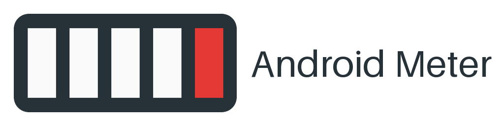
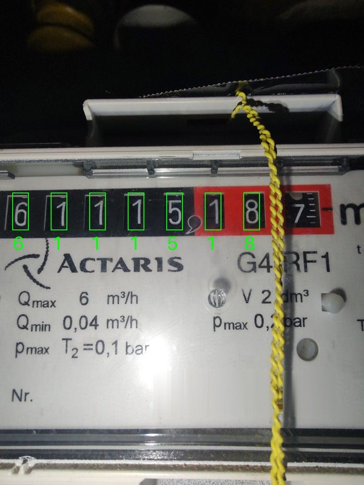

<p align="center">
  <picture>
    <source media="(prefers-color-scheme: dark)" srcset="custom_components/android_meter/brand/dark_logo.png"/>
    
  </picture>
</p>

<p align="center">
  <a href="https://github.com/renaudallard/homeassistant_android_meter/releases/latest">
    
  </a>
  <a href="https://github.com/renaudallard/homeassistant_android_meter/releases">
    
  </a>
  <a href="https://github.com/renaudallard/homeassistant_android_meter/actions/workflows/validate.yml">
    
  </a>
  <a href="https://github.com/renaudallard/homeassistant_android_meter/actions/workflows/test.yml">
    
  </a>
  <a href="https://github.com/renaudallard/homeassistant_android_meter/actions/workflows/android.yml">
    
  </a>
  <a href="https://www.home-assistant.io/">
    
  </a>
  <a href="https://hacs.xyz">
    
  </a>
  <a href="./LICENSE">
    
  </a>
  <a href="https://www.paypal.me/RenaudAllard">
    
  </a>
</p>

---

Read a **mechanical gas meter** with an old Android phone stuck to it, and
feed the reading to Home Assistant's **Energy dashboard**.

The phone sits on the meter in a magnetic holder and takes a picture of the
counter every minute or so, torch on. It posts each picture to Home
Assistant, which reads the drums itself and keeps a gas sensor in m³.

**Nothing pre-trained, no cloud.** The integration learns the digits of
your own meter from one reading you type in, and the pictures never leave
your network.

<p align="center">
  
</p>
<p align="center"><sub>
The Frame image of an Actaris G4, from a phone fixed to it with its wide
camera. Every green window was read: 61115.18 m³. The last red drum sits
apart from the others and is left out of the crop.
</sub></p>

> Two parts live in this repository: the Home Assistant integration in
> `custom_components/android_meter`, for Home Assistant **2026.11 or newer**,
> and the Android Meter app in `android`, for **Android 9 or newer**.

## Highlights

- **Learnt from your meter.** Type the reading the first picture shows, and
  the digits it holds are learnt. The others are learnt on their own as the
  meter turns, and typing a reading again later speeds that up.
- **Never ahead of the meter.** A reading is chosen among the values the
  meter can have reached since the last picture, at most the largest flow it
  is built for. Of the values that fit equally well, the lowest is taken, so
  a doubt delays the reading but never pushes it past the real one.
- **Turning drums left out.** A drum caught between two digits, a blank one
  or one unlike any known digit plays no part in the reading.
- **Wrong readings show up.** A picture whose drums show a value the meter
  cannot have reached, lower than the reading for instance, is refused and
  the status says so.
- **The phone is only a camera.** The app takes the picture, posts it, and
  waits for the interval the answer gives it: every setting lives in Home
  Assistant.
- **Local only.** The webhook only takes requests from your network, and
  the app has no dependency beyond Android itself.

## How it works

1. The app takes a picture, posts the JPEG to the integration's webhook,
   and waits for the interval the answer gives it.
2. The integration turns the picture upright, crops the counter, cuts it
   into one window per drum, and turns each window into a small black and
   white mask of its digit.
3. A drum at rest is compared with the masks learnt for each digit.
4. The reading is chosen among the values the meter can have reached since
   the last picture, and the lowest of the most likely ones is kept.
5. The same choice labels new masks: once the meter can only show one digit
   on a drum, or only one value fits, what the drum shows is learnt as that
   digit. The masks of a digit serve every drum, yet each drum keeps its
   share of them: a drum standing still on a digit for days cannot push
   out how the others, a red one say, show it.

## Installing

### The integration

Search for **Android Meter** in Settings > Marketplace (or HACS) and
install it. If it is not listed, add this repository as a custom
integration repository first:
`https://github.com/renaudallard/homeassistant_android_meter`.

To install by hand, unpack `android_meter.zip` from the latest release into
`config/custom_components/android_meter/` and restart Home Assistant.

### The app

Download `android-meter-<version>.apk` from the
[latest release](https://github.com/renaudallard/homeassistant_android_meter/releases/latest)
on the phone and open it; Android asks to allow installing from the browser
or file manager the first time. Every release carries the app, with a
version of its own that changes only when the app does: a release whose
app has the version you already run needs nothing on the phone. An update
installs over the previous one.

To build it yourself, run `./gradlew assembleRelease` in `android/` (JDK 21,
Android SDK platform 37).

### Versions

Up to 0.1.13 the app and the integration were released under one version;
since then the app gets a new version only when it changes.

| Integration | App it ships with |
|-------------|-------------------|
| 0.1.0 to 0.1.13 | the same version |
| 0.1.14 | 0.1.13 |

Every app sends its pictures the same way and every integration answers
the same way, so any pair reads the meter. What the phone does beyond
that needs both sides at least at the version that brought it:

| App \ Integration | 0.1.0 to 0.1.1 | 0.1.2 to 0.1.4 | 0.1.5 to 0.1.6 | 0.1.7 and later |
|---|---|---|---|---|
| 0.1.0 to 0.1.1 | reading | reading | reading | reading |
| 0.1.2 to 0.1.4 | reading | + QR pairing | + QR pairing | + QR pairing |
| 0.1.5 to 0.1.6 | reading | + QR pairing | + crop on the phone | + crop on the phone |
| 0.1.7 and later | reading | + QR pairing | + crop on the phone | + Find the counter |

Without QR pairing the webhook address is typed into the app; without the
crop on the phone, the crop is set in Home Assistant.

## Setting up

1. **Mount the phone** on the meter with the back camera over the counter,
   close enough for the drums to fill a good part of the picture but no
   closer than the camera can focus. Keep it on its charger.
2. **Add the integration**: Settings > Devices & services > Add integration
   > Android Meter. Give the meter a name. The next screen shows a pairing
   QR code and the webhook address, for example
   `http://192.168.1.10:8123/api/webhook/...`.
3. **Pair the app**: scan the QR code with the phone's camera and share the
   text it shows to Android Meter, or copy it and press **Paste the pairing
   link** in the app. The app asks whether to send the pictures to that Home
   Assistant; it names only the host, as the rest of the address is the
   webhook's secret. The code is also in Configure > Phone and pairing. Typing
   the address in the app works too.
4. **In the app**, pick the camera (the list shows how close each one
   focuses) and press **Take one picture**. A phone close to the meter
   wants the camera that focuses closest, often the wide one, which also
   sees the most. Some phones, Motorola's among them, leave their extra
   back cameras out of Android's list; the app offers them all the same. The picture is shown in the app
   and sent to Home Assistant, upright however the phone is held. The first
   time, Android asks to let the app use the camera, post its notification
   and, from Android 17, reach the local network, which Android files
   under nearby devices.
5. **Set the crop on the phone**: press **Set the crop** in the app, then
   **Find the counter**: Home Assistant looks for the row of drums on the
   last picture and sets the box, the drums, the decimal drums (the red
   ones) and the gap. Check that each green frame sits on one window. If
   not, or if no counter was found, drag the yellow box over the drum
   windows yourself, moving it from its middle and sizing it from its
   corners, set the drums, decimal drums and gap with the − and + buttons,
   and press **Save the crop**. A crop found on a picture other than the
   one the editor shows, from another camera say, is set all the same but
   not drawn: check it on the Frame image.

   A drum hidden by a glare between two others is counted all the same,
   but one hidden at either end, behind a seal wire or out of the picture,
   is left out of the crop. Drums left out on the right make the reading
   coarser. Drums left out on the left cost nothing: they only turn when
   the drum to their right goes from 9 to 0, so the reading carries them
   on its own. A phone that cannot be set far enough back to see the whole
   counter is best aimed at the last drums, red ones included.

   The meter's device page has the same settings as controls, next to the
   **Frame** image, for fine tuning: **Rotation**, **Crop left, top,
   width and height**, **Gap between windows**, **Drums** and **Decimal
   drums**. Each change redraws the Frame image with every window
   outlined. Turning the picture starts the crop anew.
6. **Teach the reading**, see below. Settings also shows a Repairs notice,
   **Gas meter needs a reading** (the meter's name), until it is done.
7. **Start** the app. It keeps taking pictures with the screen off, as a
   foreground service with its notification showing. Press **Let it run
   without battery limits** once, so Android does not stop it to save
   battery.

## Teaching the digits

The integration learns the digits of your meter from the readings you type
in, then goes on learning on its own as the meter turns.

1. Open Configure > **Teach the reading**, or press **Fix** on the Repairs
   notice. The screen shows the last picture with each drum outlined. The
   **Teach the reading** box on the device page does the same. The picture
   is the Frame image's: with that image disabled nothing is taught, as no
   picture shows what to type. An image enabled again shows about 30
   seconds later, once Home Assistant has reloaded the meter.
2. Type the meter's reading, every drum from left to right, for example
   `01234.567`, drums left of the crop included. Decimal drums right of
   the crop may be typed too; they are left out. A drum caught between two
   digits counts as the lower one.
3. Save. Every drum of the crop showing a whole digit is learnt, the
   status turns to OK, and **Lock the crop** turns on. A status of
   Waiting for the phone or Phone offline stays until the next picture.

The screen lists the digits learnt and the ones still to learn. On the
device page, the **Learnt digits** sensor counts them and **Digits to
learn** lists the ones missing. Teaching again later, when the meter shows
other digits, gets all ten sooner. **Forget the digits learnt** starts
over, for instance after a wrong reading was typed.

Until a digit is learnt, a drum showing it is left out: the Frame image
outlines it in orange, with the nearest known digit under it, and the
reading stays at the last value it is sure of rather than guess. The
digits not taught are learnt as the meter turns, whenever a picture leaves
only one possible digit for a drum at rest. How long that takes depends on
how much gas flows. In simulation of a counter of 8 drums, 3 of them
decimal, with gas flowing about a sixth of the time at 1 to 2.5 m³/h, one
reading taught got all ten digits learnt after 5 to 30 hours, once 1 to
6 m³ had gone through. A meter that turns little learns slower. Teaching
the reading again when a drum shows one of the **Digits to learn** learns
it at once.

A change of crop forgets the digits learnt, since they no longer match the
windows. A change of **Decimal drums** keeps them but drops the reading,
which the drums no longer show on the same scale: teach it again. **Lock the crop** keeps a slip from doing that: while it is on, the
crop and counter controls, **Find the counter** and the phone's crop editor
are refused. Turn it off to move the crop, then teach the reading again.

## Settings

On the meter's device page:

| Control | Meaning |
|---|---|
| Rotation | Clockwise turn that makes the digits upright. |
| Crop left, top, width, height | The windows, in pixels of the turned picture. |
| Gap between windows | Housing between two windows, in pixels. |
| Drums, Decimal drums | How many drums the crop holds, and how many of them are after the decimal point. |
| Lock the crop | On, the controls above and Find the counter refuse changes. Turns on when a reading is taught. |
| Teach the reading | Type the meter's reading, as the Frame image shows it, to teach it. |
| Forget the digits learnt | Start learning again. |
| Find the counter | Find the row of drums on the last picture and set the crop around it. |

In Configure, a menu of two screens:

| Screen | Options |
|---|---|
| Teach the reading | The meter's reading, with the last picture; Forget the digits learnt. |
| Phone and pairing | The pairing QR code; interval (10 to 3600 s, 60 by default); torch; largest flow (6 m³/h for a G4, 10 for a G6). |

## What you get

| Entity | Description |
|---|---|
| Reading | The meter in m³, device class gas, state class `total_increasing`. Use it in the Energy dashboard as gas consumption. |
| Status | How the last picture went (see below). |
| Learnt digits | How many of the ten digits are known. |
| Digits to learn | The digits not learnt yet, for example `2 3 5 7 9`, or `none`. |
| Frame | The last picture, upright, with each window outlined: green when it was read, orange when it was not, yellow when the last picture was not read: until a reading is taught and the next picture comes, or after one the crop does not fit or that could not be opened, `~` under a drum caught between two digits. Redrawn on every change of crop. |

In Belgium, [Belgian Gas Prices](https://github.com/renaudallard/homeassistant_be_gas_prices)
prices the Reading sensor with every part of the bill, and keeps the running
cost of the year and of the month.

| Status | Meaning |
|---|---|
| Waiting for the phone | No picture since Home Assistant started, or the integration was reloaded. |
| Phone offline | No picture for three intervals, and at least five minutes. |
| Unreadable picture | The phone sent something that is not a JPEG, a damaged or progressive one, or one over 12 megapixels. |
| Crop not set | Set the crop on the phone, or with the controls on the device page. |
| Crop outside the picture | The crop does not fit the picture. |
| Reading to teach | Teach the reading (Configure > Teach the reading, or the Repairs notice). |
| Digits not recognised | No drum at rest matched a known digit: light, focus, or the phone moved. |
| Implausible reading | The drums show a value the meter cannot have reached. Check the reading, and type the right one. |
| OK | The picture was read. |

## Good to know

- The reading lags while gas flows: the low drums are caught turning and
  are not read. It catches up when the meter stops. A meter that stopped
  mid-carry, with drums between two digits, keeps the reading slightly
  behind until gas flows again.
- Android only lets an app start the camera from something the user did.
  After a reboot, an update of the app, or Android stopping it, the app
  therefore cannot start again on its own: it posts **The meter watch
  stopped**, and a tap on that notification starts it again. Should a
  permission be missing, taken back or new with an update of Android, the
  notification opens the app to ask for it first; one taken back after
  the notification came up brings it up again, to do so. Refusing it there
  ends the watch: no notification comes back until **Start** is pressed.
  A watch started during **Take one picture** waits for that picture.
- A reading typed lower than the current one is a correction. Up to 10%
  lower, Home Assistant counts the difference as negative consumption and
  logs once that the sensor is not strictly increasing. More than 10%
  lower, it takes the meter for one that was reset, and counts the whole
  new reading as consumption: a slip of the decimal point corrected that
  way shows as a spike in the Energy dashboard, to be taken out with
  **Adjust sum** in Settings > Tools > Statistics.
- The webhook address holds the webhook's secret: the app never sends it
  anywhere else, does not follow redirects, and keeps it out of Android
  backups, of Recents and of screenshots of the app. The pairing dialog
  shows only the host, as the connection spells it, so that a name made of
  look-alike letters shows for what it is.
- Over plain http, anyone who can watch your network's traffic can read
  the address. On Android 12 and older, Android also logs a pairing link
  opened as a link, address included: share or paste the scanned text
  instead.
- The recognition was developed on synthetic pictures of a drum counter,
  rolling drums, carries, uneven light and noise included, and checked on a
  real Actaris G4. Marks printed under the digits and a glow across a
  window are handled; a glare streak across a digit, or a seal wire in
  front of it, is not, so place the phone and its torch to keep the
  windows clear. Reports with the Frame image are welcome.

## Reporting a problem

Download the integration's diagnostics (device page, three dots menu) and
attach them with a Frame image. They hold the options, the status, the
reading, how many masks each digit has and the drum each came from, never
the webhook address or the pictures.

## Development

```shell
python -m pip install -r requirements-dev.txt
ruff check . && ruff format --check .
mypy --strict custom_components/android_meter
pytest
```

The tests use `pytest-homeassistant`, the test package Home Assistant
publishes with each release, at the version of `homeassistant` pinned in
`requirements-dev.txt`. `tests/synth.py` draws the synthetic meter, and
`tests/test_simulation.py` runs hours of a meter in use through the reader.

## License

BSD 2-Clause, see [LICENSE](LICENSE).
